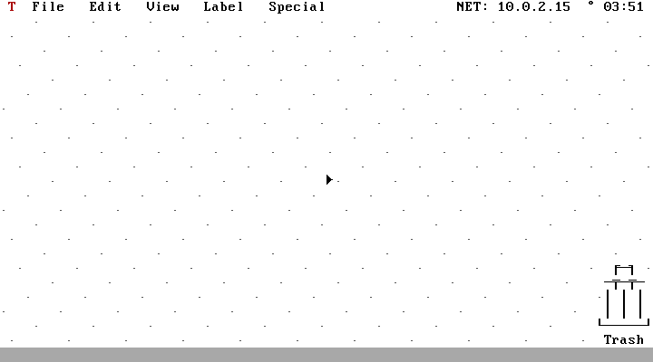
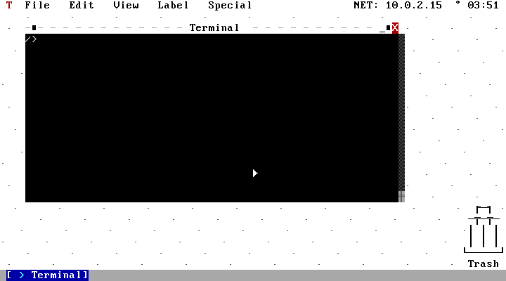

# tOS

A 64-bit hobby operating system, written from scratch. It boots to a desktop, has its own network stack and browser, and runs real Linux programs.

**Made by Artfical DT.**

<table>
<tr>
<td><br>The desktop</td>
<td><br>Terminal</td>
</tr>
</table>

## What it does

- **Runs Linux programs.** 64-bit and 32-bit ELF programs, static or linked against glibc: Node.js, Python 3.9 to 3.14, Git, OpenSSH, vim, tmux, gcc, make, cmake, Perl, Go, Rust, bash and more. Windowed programs run on an X server (`xorg`, `tcltk`, tkinter).
- **Packages.** `tpkg` installs them from the update server. Every package is signed and checked on install; gcc, the C library headers and the build tools are separate packages.
- **Desktop.** Window manager, Files, Settings, Terminal, Paint, Notepad, notifications, Disk Utility, an installer and a recovery screen.
- **tFire**, the web browser: HTTPS, HTML and CSS, JavaScript, images.
- **Network.** IPv4 and IPv6, TCP, UDP, TLS, DNS, DHCP, and a built-in SSH server through the `openssh` package.
- **Storage.** A RAM file system, tFS, FAT, exFAT and ext2/3/4 for disks and USB sticks.
- **Scripting.** MicroPython and T# are built in.
- **Software Update.** The system updates itself from the update server.

## Try it

Every commit on `main` is built and published as a release with `tOS.iso` attached. Download it from the [Releases](https://github.com/Artfical/tOS/releases) page and boot it in QEMU, VirtualBox or VMware, or write it to a USB stick.

```bash
qemu-system-x86_64 -cdrom tOS.iso -m 2048 -vga std -nic user,model=e1000
```

On a fresh machine tOS starts in Recovery: install it, or choose *Try tOS in Live Environment* (user `tos`, no password).

## Build from source

You need GCC for x86-64 (with `gcc-multilib`), GNU Make, `xorriso` and the GRUB tools (`grub-mkrescue`).

```bash
git clone https://github.com/Artfical/tOS.git
cd tOS
make          # builds tOS.iso
make run      # starts it in QEMU
```

## Packages

```
tpkg look                 # the packages on the server for this build
tpkg install gcc          # install a package (and what it depends on)
tpkg info python3         # version, licence, size, signature
tpkg list                 # what is installed
```

## Requirements

x86-64 CPU, 1 GB of memory or more recommended (Linux programs and packages live in RAM), BIOS boot through GRUB, a Bochs/QEMU/VirtualBox VBE display for the desktop, a PS/2 keyboard. Supported network cards: virtio-net, E1000, RTL8139, PCnet, NE2000.

## Documentation

Read it at **[docs.artfical.com/tos](https://docs.artfical.com/tos)**. Its sources are in `docs/site/`; `tools/gen_docs_site.py` builds the pages. `docs/reference.md` is the older, long feature-by-feature description.

## Contributing

Bug reports and pull requests are welcome. Read [CONTRIBUTING.md](CONTRIBUTING.md) first. Be kind to each other: [Code of Conduct](CODE_OF_CONDUCT.md). Found a security problem? Do not open a public issue: see [SECURITY.md](SECURITY.md).

## License

tOS is licensed under the **GNU Affero General Public License v3.0**. See [LICENSE](LICENSE).

tOS includes the work of others, each under its own licence: MicroPython, QuickJS, wasm3, NetSurf's libraries, doomgeneric, Wolf4SDL, the Inter and JetBrains Mono fonts, the WhiteSur and Lucide icons, and more. They are listed with their licences in [THIRD_PARTY_NOTICES.md](THIRD_PARTY_NOTICES.md), and every copy of tOS carries that file (tFire shows it at `tfire:licenses`).

## Disclaimer

tOS is for learning and experiments, not for production use. It comes with no warranty.
