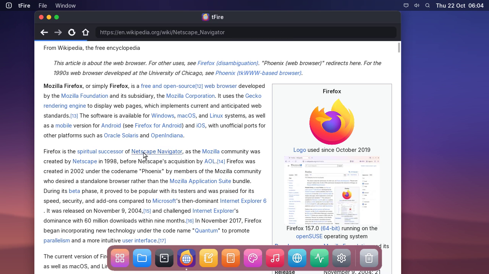
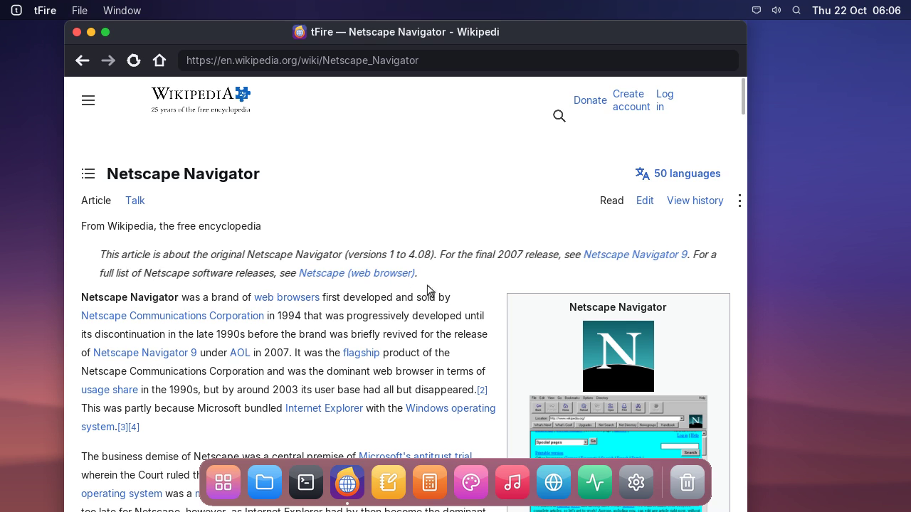
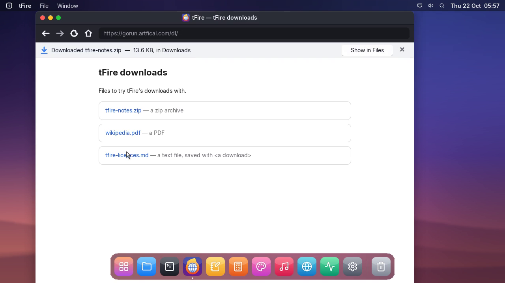
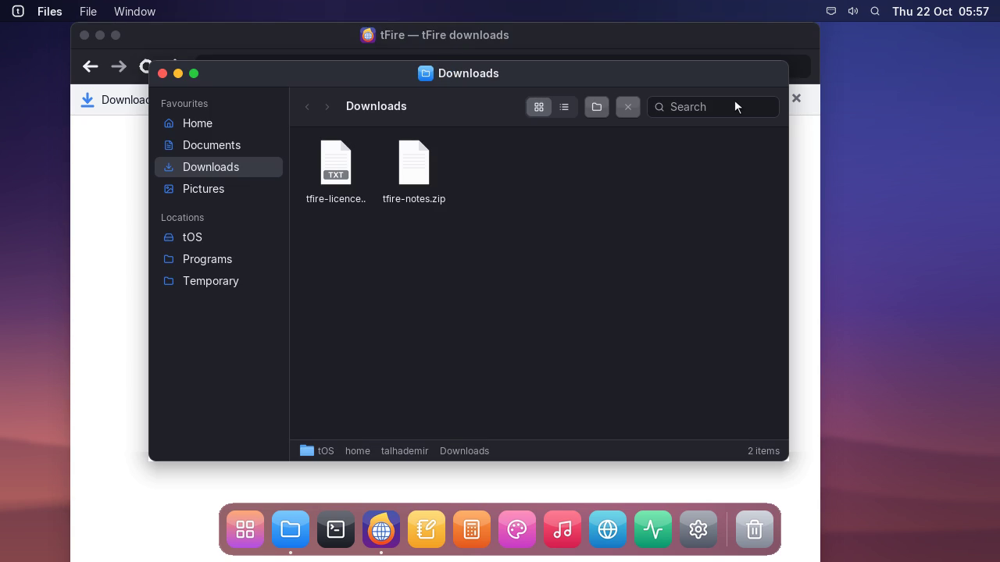

# Project tFire, update 4: links and downloads

## tfire | tFire
- Click a link and the page you are on stays on screen, with the loading bar, until the next one
  arrives: no more blank window while a big page like Wikipedia loads.
- Downloads: files tFire cannot show (zip, PDF and the like), files a site sends as attachments and
  links marked download are saved in Downloads, and you stay on the page.
- A bar at the top says what was saved and how big it is; Show in Files opens it in Files. A file
  whose name is taken is kept as "name (2)".

