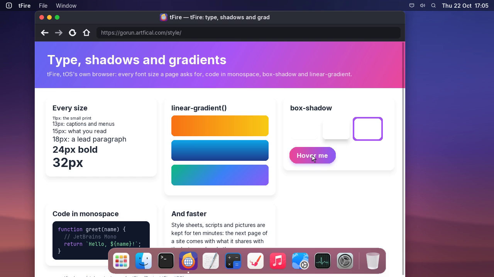
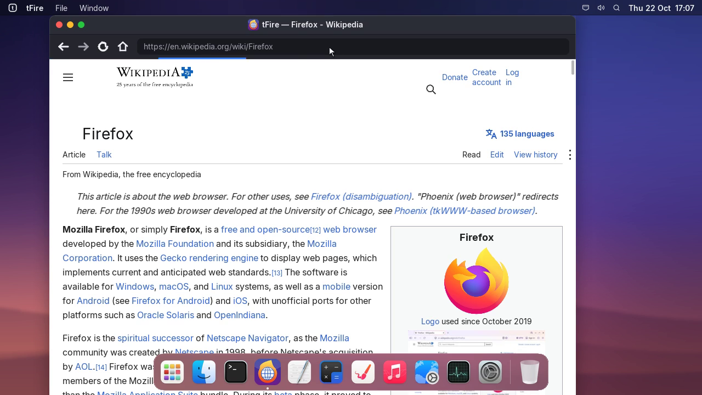

# Project tFire, update 6: type, shadows and gradients

## tfire | tFire
- Pages are drawn in the font sizes they ask for: Inter in 13 sizes from 10 to 40 pixels, regular and
  bold, instead of five. Wikipedia's text is now its real 16 pixels.
- Code is drawn in a monospace font (JetBrains Mono): pre, code and anything set in monospace.
- box-shadow: soft shadows under cards, buttons and menus, with their blur, spread and colour.
- linear-gradient(): backgrounds that blend from colour to colour, at any angle, with up to four stops.
- A cache: style sheets, scripts and pictures are kept for ten minutes, so the next page of a site
  comes with what it shares with the last one already there (on Wikipedia, about half of it).
- Try them at gorun.artfical.com/style.

## settings | Software Update
- Videos in the release notes play smoothly: frame by frame, ten a second, however long they are,
  instead of a few frames a second.
