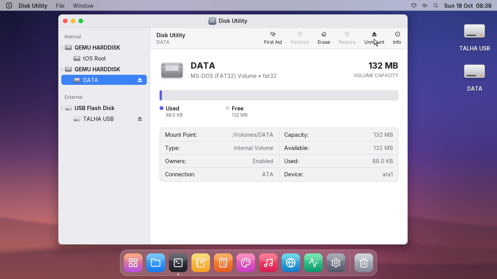

# Software Update and faster USB disks

## settings | System Settings
- Software Update: tOS now looks for updates at update.artfical.com, shows what is new, downloads
  the update with its progress and speed, and installs it while restarting.

## diskmgr | Disk Utility
- USB disks are written and erased much faster: a 64 MB disk is erased in seconds.
- The desktop keeps running while a slow disk is busy.

## launcher | tOS Recovery
- Account names made from Turkish full names: "Demır" becomes "demir".
