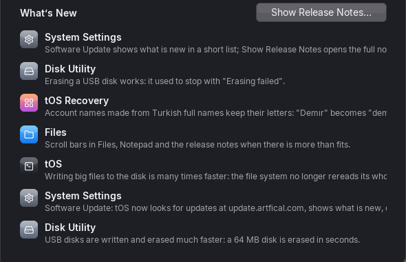
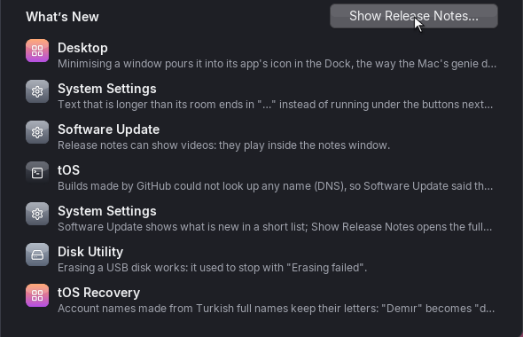

# Tidier Software Update

## settings | System Settings
- What's New lines end in "…" instead of being cut off mid-word at the edge of the window.
- The line under the update's name no longer runs through the build number.
- Updating no longer fails with "Not enough memory for the update" after watching the videos
  in the release notes.

