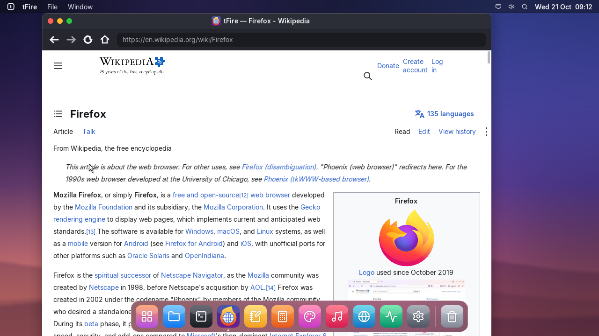
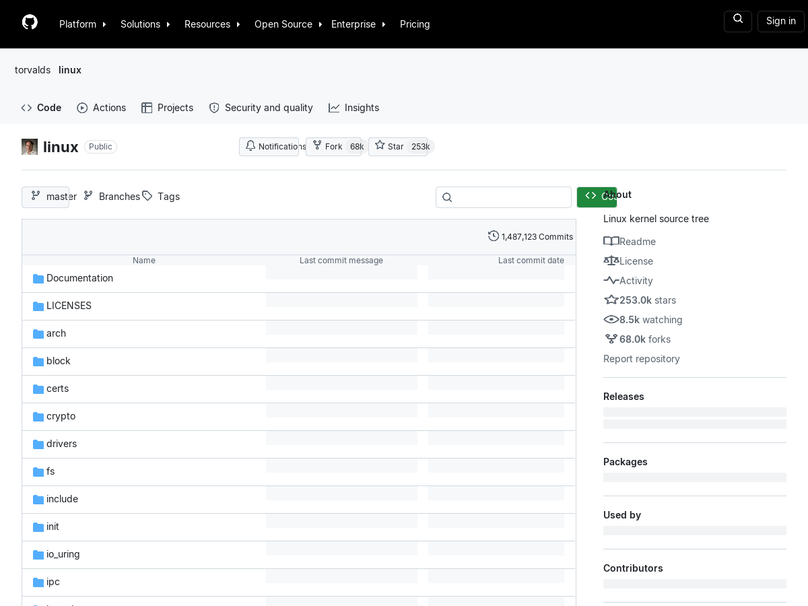
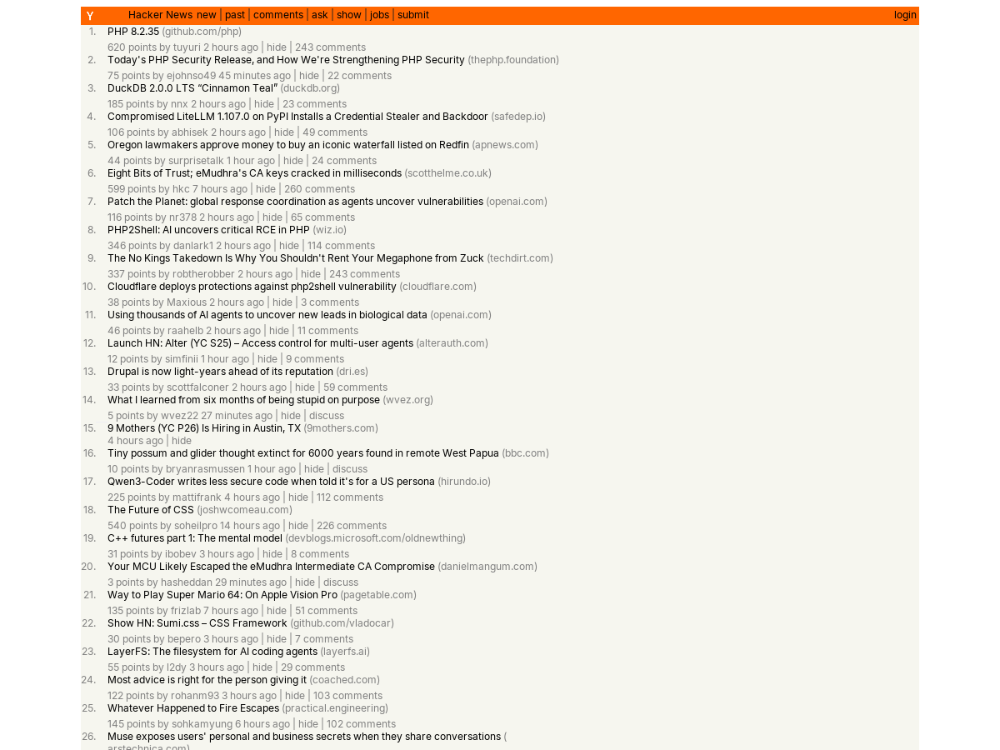
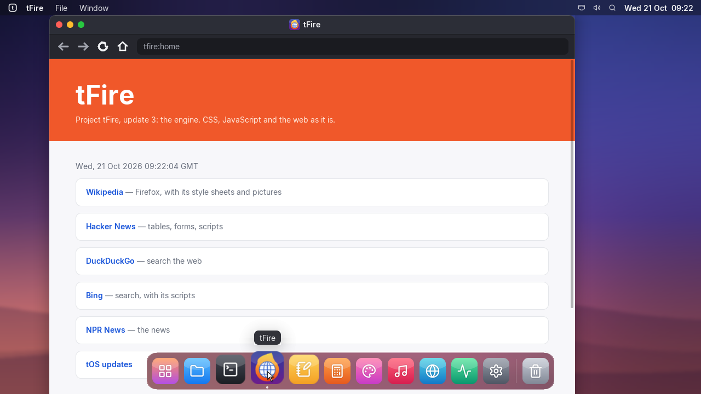
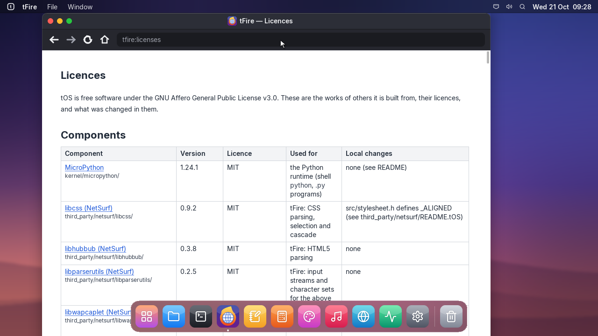

# Project tFire, update 3: the engine

## tfire | tFire
- This is the third update of Project tFire: tFire gets a real web engine, so pages look the way
  their designers made them.
- HTML is read the way browsers read it (libhubbub), style sheets are applied (libcss), with grid,
  flex, floats, CSS variables and calc().
- JavaScript runs (QuickJS, ES2023): pages change themselves, react to clicks and the mouse, and
  fetch data. Forms and cookies work.
- Pictures in SVG and WebP as well as PNG and JPEG; icons drawn from inline SVG.
- Hover effects, and the address of the link under the pointer at the bottom of the window.

## about | Added tFire licences
- tFire is built on the work of others, and their licences come with it: tFire shows them all at
  tfire:licenses, and THIRD_PARTY_NOTICES.md lists them.
- libhubbub, libcss, libparserutils, libwapcaplet (NetSurf, MIT), QuickJS (MIT), musl's maths (MIT),
  compiler-rt builtins (Apache 2.0 with LLVM exception), NanoSVG (zlib), libwebp (BSD).

## settings | Software Update
- Restarting to install an update starts the new build again: build 580, larger than the builds
  before it, was installed but could not be started from them until the computer was turned off and on.
