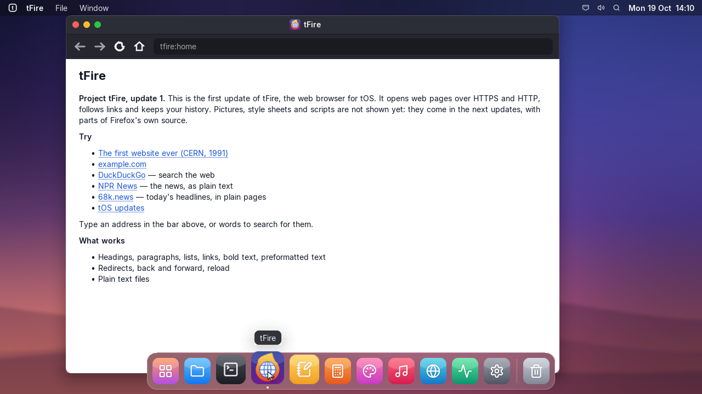
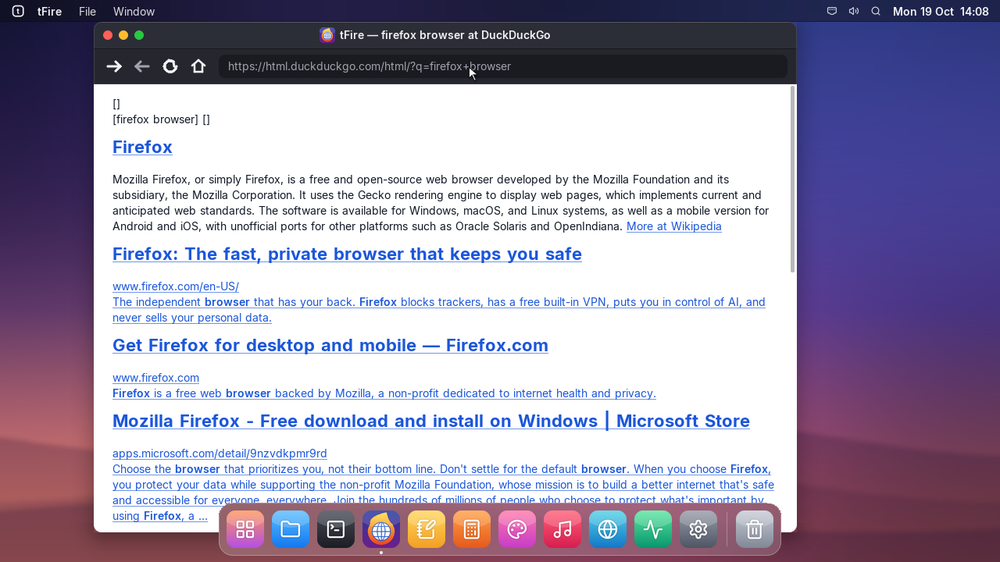
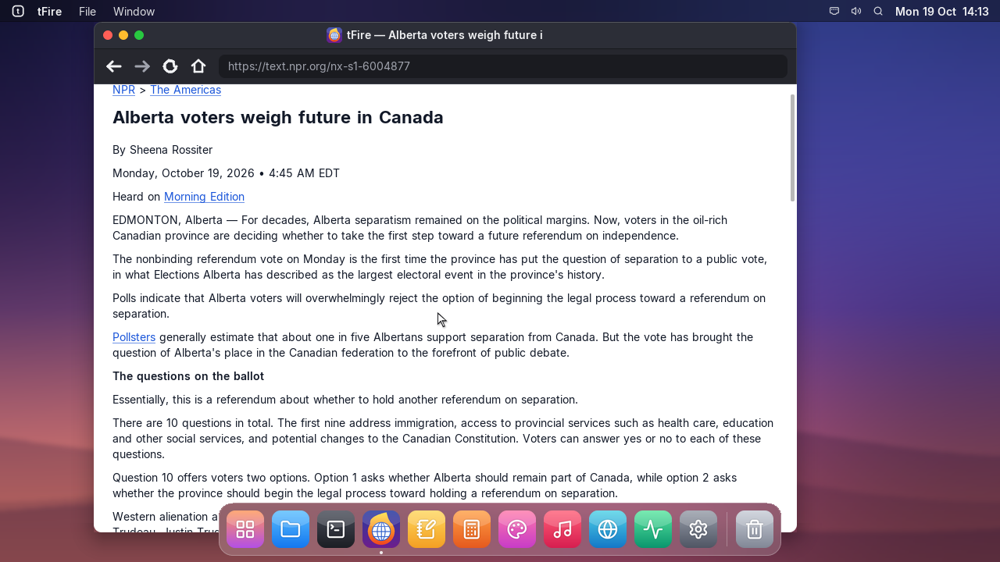

# Project tFire, update 1

## tfire | tFire
- This is the first update of Project tFire: tOS gets its own web browser, tFire, in the Dock.
- Opens web pages over HTTPS and HTTP, follows redirects and links, with back, forward, reload
  and a home page.
- Type an address in the bar, or a few words to search the web (DuckDuckGo).
- Shows headings, paragraphs, lists, links, bold and preformatted text, and plain text files.
- Pictures, style sheets and scripts come in the next updates of Project tFire.

