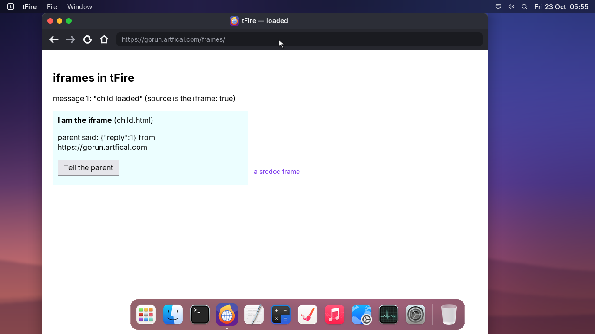
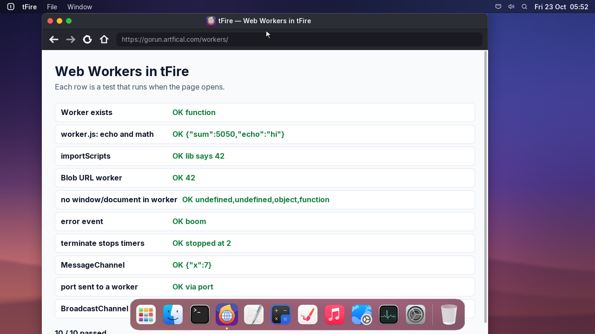
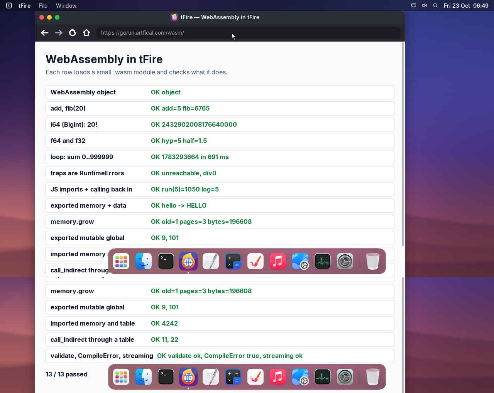

# Project tFire, update 7: iframes, Web Workers and WebAssembly

## tfire | tFire
- iframes: a page inside a page, drawn in its box, with its own scripts; clicks, keys and the pointer
  go to it, and the two talk with postMessage. srcdoc frames too.
- Web Workers: new Worker(), importScripts, workers from Blob URLs, MessageChannel and ports, and
  BroadcastChannel.
- WebAssembly: modules run on wasm3 (MIT), with Module, Instance, instantiate, memory and
  memory.grow, globals, tables, i64 as BigInt, JavaScript imports, and instantiateStreaming.
- fetch() and XMLHttpRequest give binary bodies exactly (arrayBuffer, blob).
- Try them at gorun.artfical.com/frames, /workers and /wasm.

## about | Licences
- wasm3 (MIT) is in third_party/wasm3 with its licence; tFire lists it at tfire:licenses.
