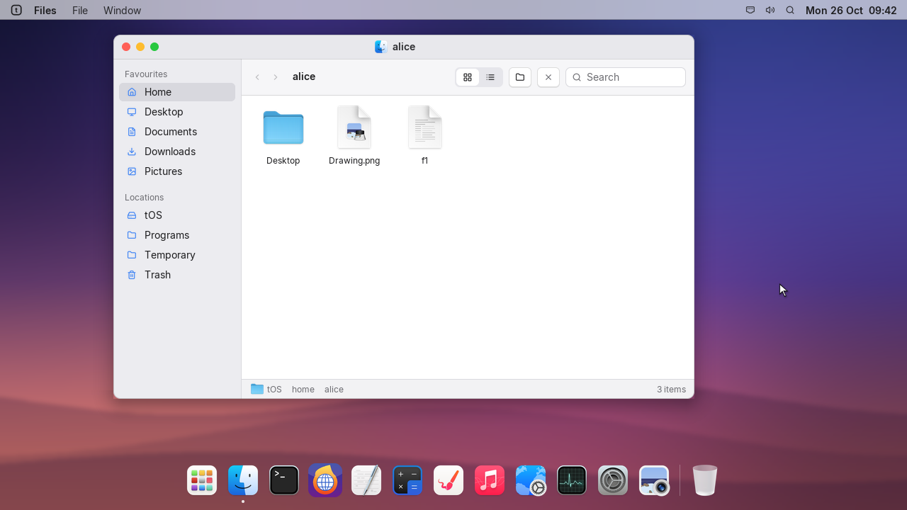
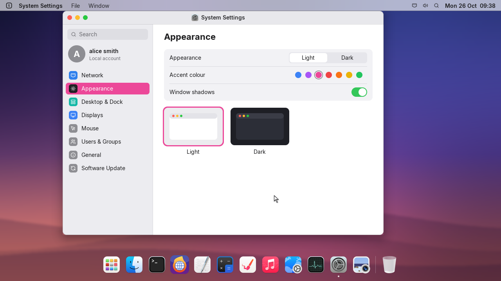
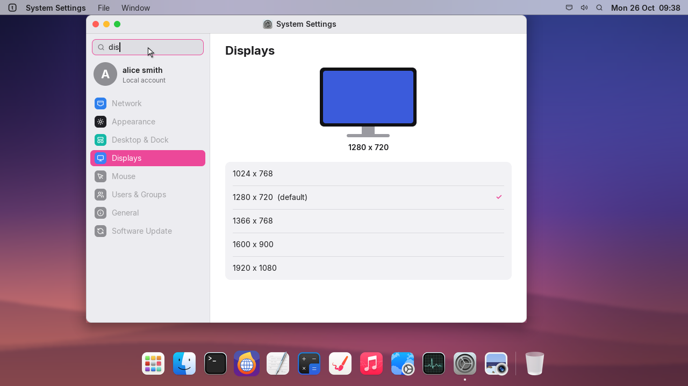
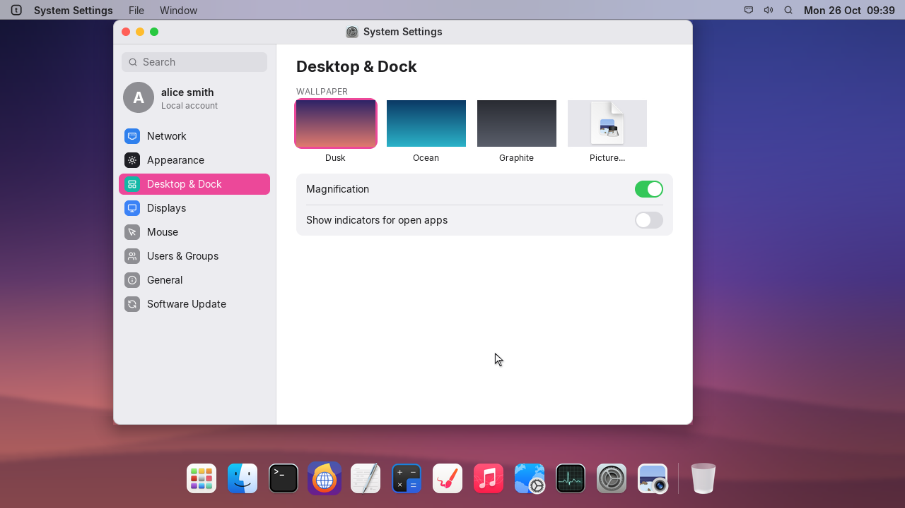
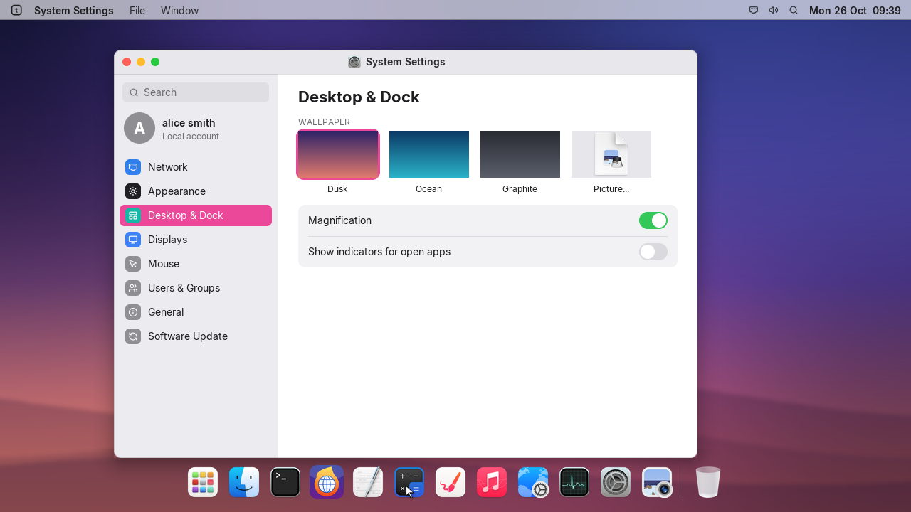

# A new start-up, VMware graphics, and Settings that all work

## about | Start-up and VMware
- tOS now starts with the Artfical animation, played at its own speed with smooth scaling, and ends on the logo.
- VMware (SVGA II) shows the boot screen, tOS Recovery and the desktop instead of a black screen or the old text console.
- VMware needs at least 4 MB of graphics memory for 1280 x 720; with less, tOS starts in text mode and writes the reason to the serial log.

## settings | System Settings
- Accent colour now changes buttons, selections and highlights across tOS, and is remembered.
- The Window shadows and the Show indicators for open apps switches now work.
- Type in Search to find a section; the first match opens as you type.

## launcher | Desktop and Dock
- The Dock is transparent, and windows stop at the Dock instead of sliding under it.
- tOS Recovery no longer responds to clicks on its hidden Dock.
- The pointer speeds up smoothly, and screen updates on VMware no longer wait for each frame.
- Interface beeps are off by default; turn them on with `beep on` in Terminal.

