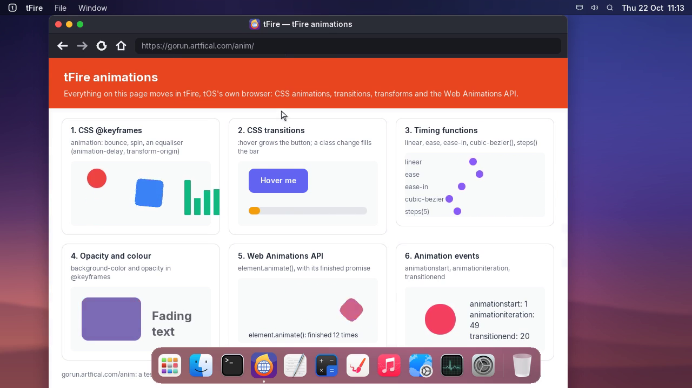
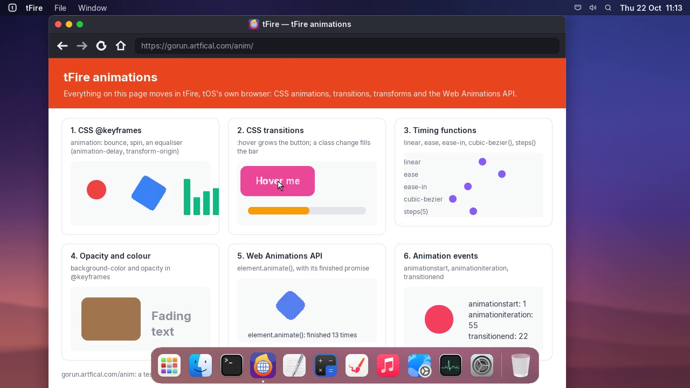

# Project tFire, update 5: animations

## tfire | tFire
- CSS animations: @keyframes, with every animation property (duration, delay, iteration count,
  direction, fill mode, play state) and the animation shorthand.
- CSS transitions: when the pointer moves onto something (:hover), when a field gets the keyboard
  (:focus) and when a script changes a class or a style.
- Transforms: translate, scale, rotate and matrix, transform-origin, and the translate, rotate and
  scale properties. Turned boxes, words and pictures are drawn with smooth edges.
- Timing functions: linear, ease, ease-in, ease-out, ease-in-out, cubic-bezier() and steps().
- What can move: opacity, colours (text, background, border), sizes and positions (width, height,
  top, left, margins, max-height), font size and rounded corners.
- The Web Animations API: element.animate(), with play, pause, reverse, finish, cancel, currentTime
  and the finished promise, and getAnimations().
- Scripts hear about it: animationstart, animationiteration and animationend; transitionrun,
  transitionstart, transitionend and transitioncancel.
- Try them all at gorun.artfical.com/anim.

