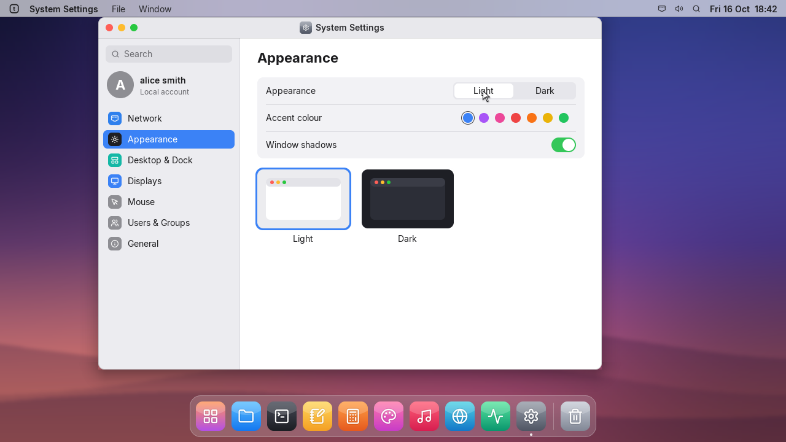
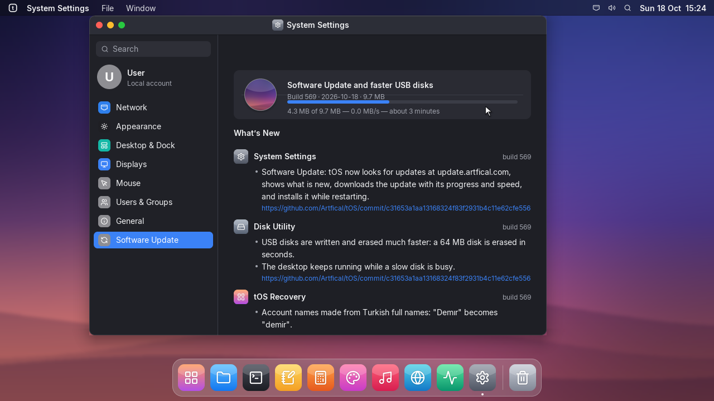
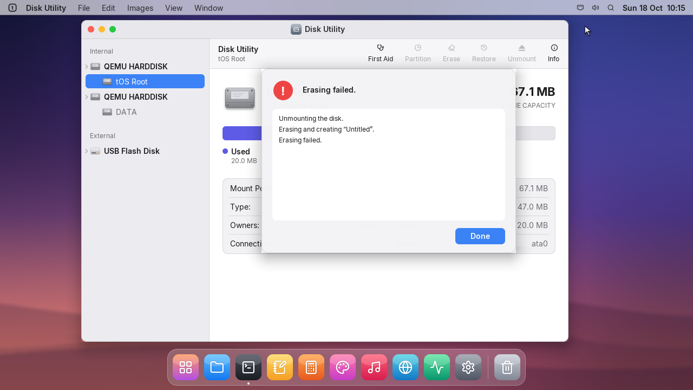
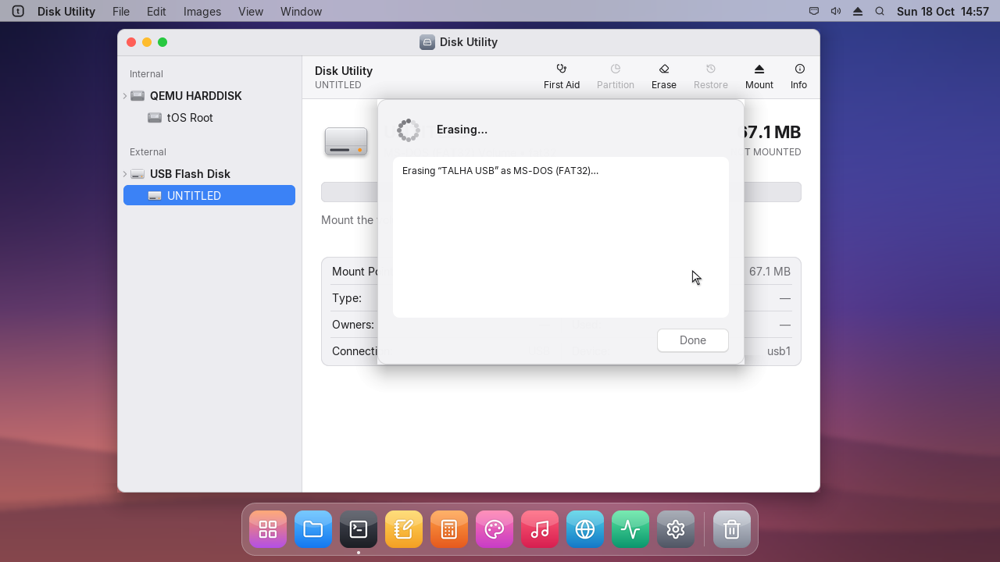
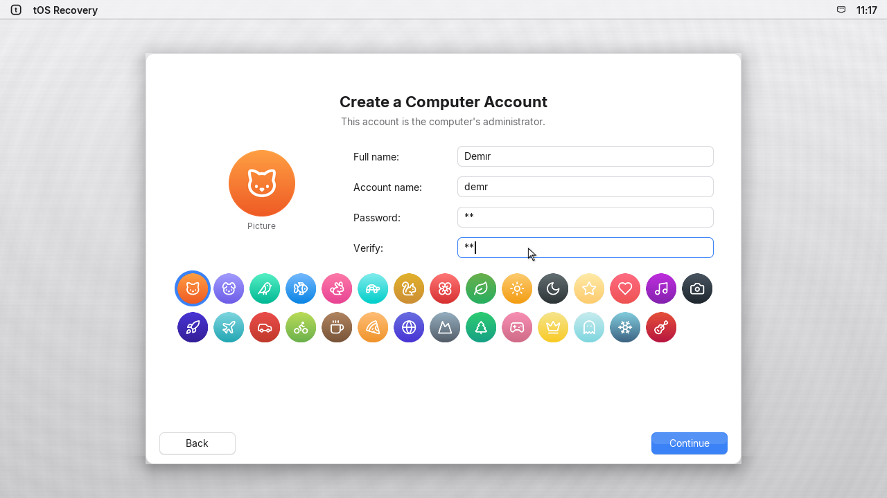
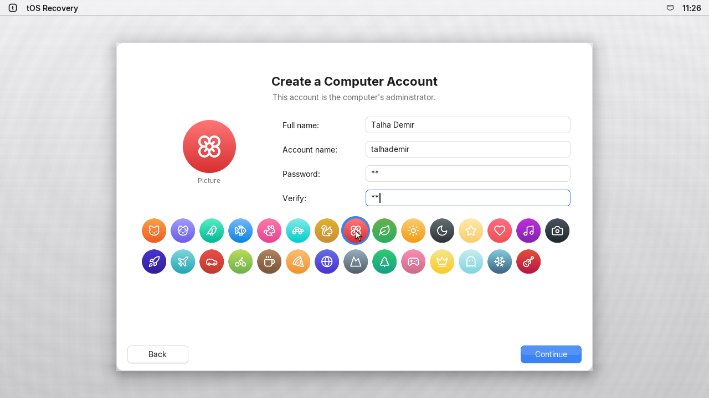

# Release notes with before and after, faster disk writes

## settings | System Settings
- Software Update shows what is new in a short list; Show Release Notes opens the full notes in
  a window of their own, with each app's changes, the commits, and before/after screenshots.
- A notification says when an update is available, and insists when tOS is far behind.

## diskmgr | Disk Utility
- Erasing a USB disk works: it used to stop with "Erasing failed".
- The desktop keeps running while a slow disk is busy.

## launcher | tOS Recovery
- Account names made from Turkish full names keep their letters: "Demır" becomes "demir".

## files | Files
- Scroll bars in Files, Notepad and the release notes when there is more than fits.

## terminal | tOS
- Writing big files to the disk is many times faster: the file system no longer rereads its
  whole block bitmap for every block. Downloading and installing an update takes seconds.
