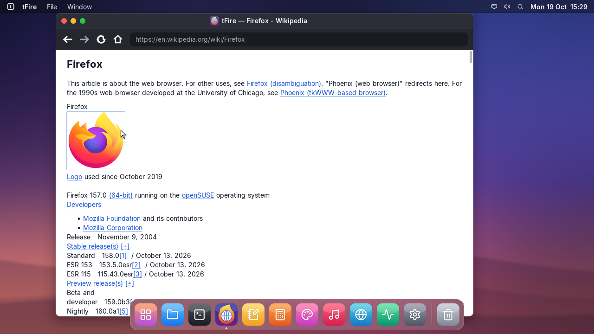
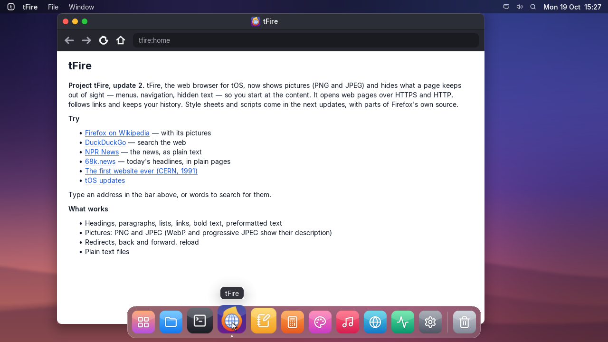

# Project tFire, update 2: pictures

## tfire | tFire
- This is the second update of Project tFire.
- Pages show their pictures (PNG and JPEG); a picture that is a link can be clicked.
- What a page keeps out of sight — menus, navigation, text for screen readers — stays hidden,
  so Wikipedia and other sites start with the article instead of a wall of links.
- WebP and progressive JPEG pictures show their description for now.

