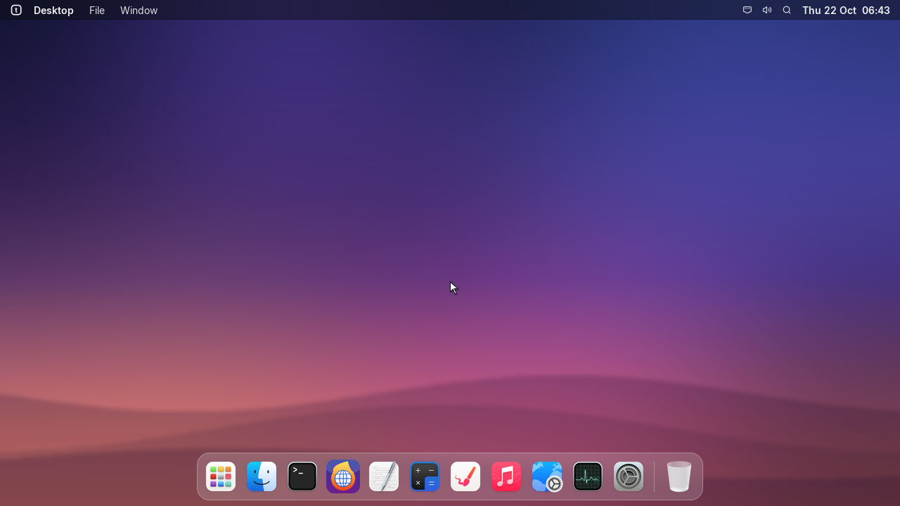
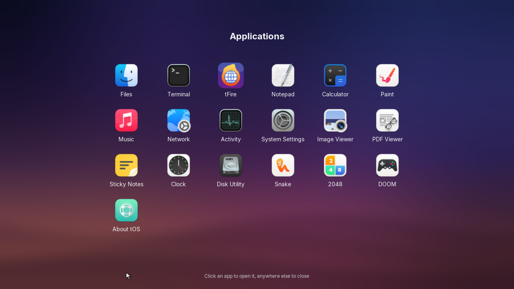
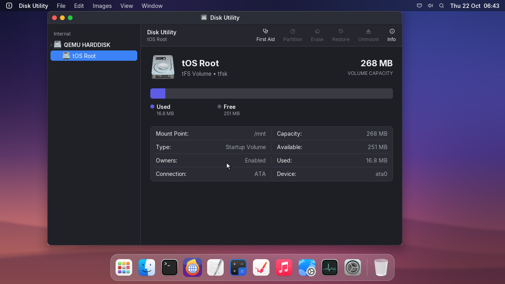
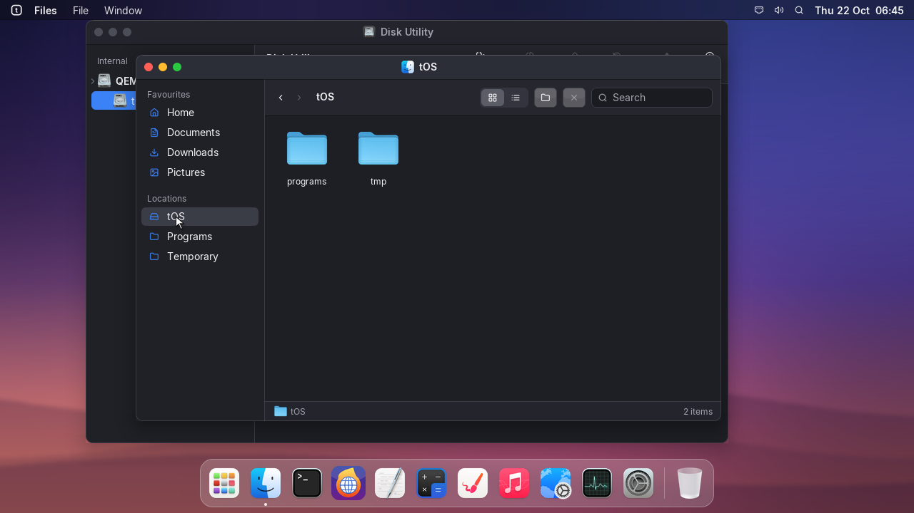
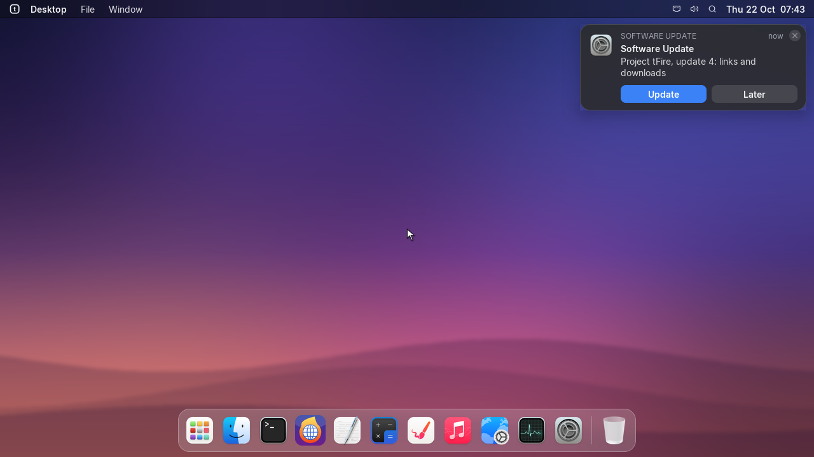

# New icons, and the update notification fixed

## launcher | tOS
- New macOS-like icons for every app, in the Dock, the launcher and the menus, from the WhiteSur icon
  theme by Vince Liuice (GPL-3.0).
- Files, folders and disks have new icons too: in Files, on the desktop and in Disk Utility.

## settings | Software Update
- The notification that a new version is ready no longer stops builds 577 and 578: until this one
  is installed, they find it in Settings > Software Update instead.

## about | Licences
- The WhiteSur icon theme is in third_party/whitesur-icons with its licence (GPL-3.0); tFire lists
  it at tfire:licenses with the rest.
