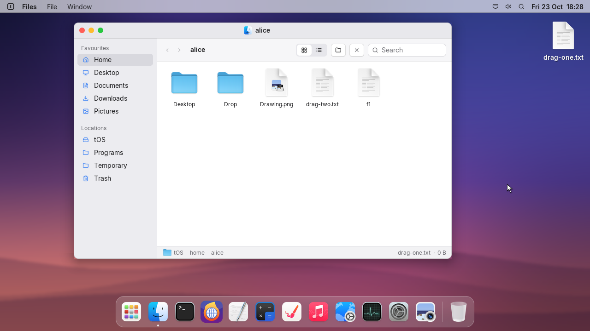
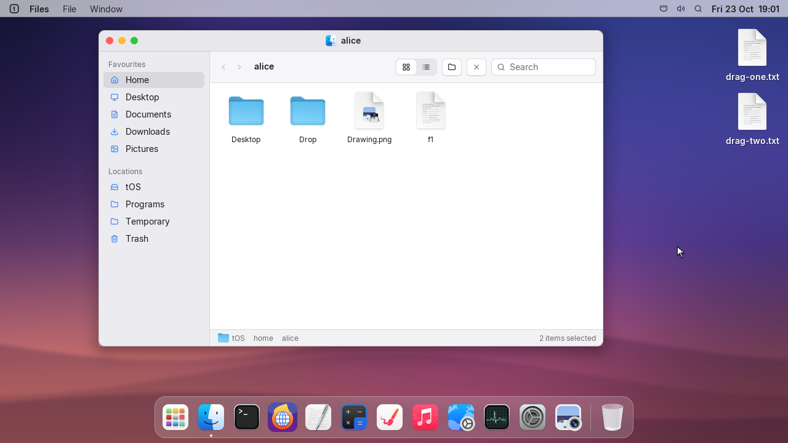
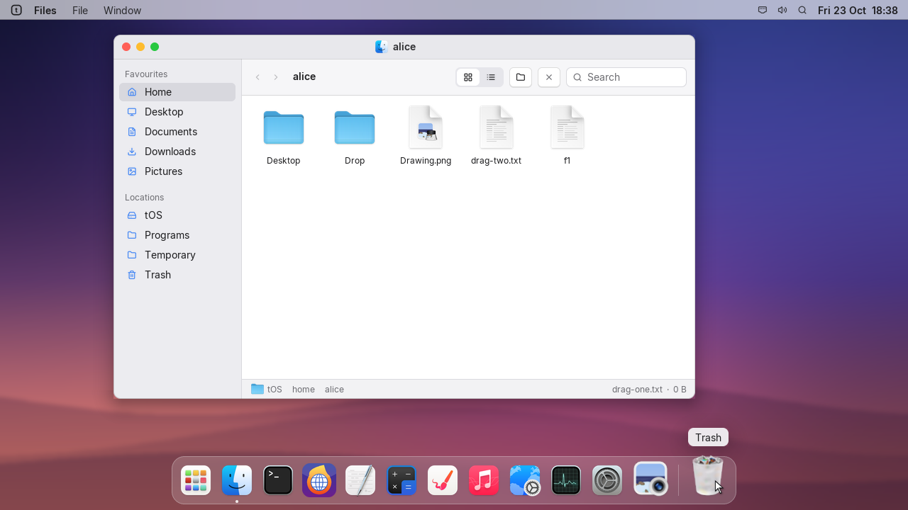
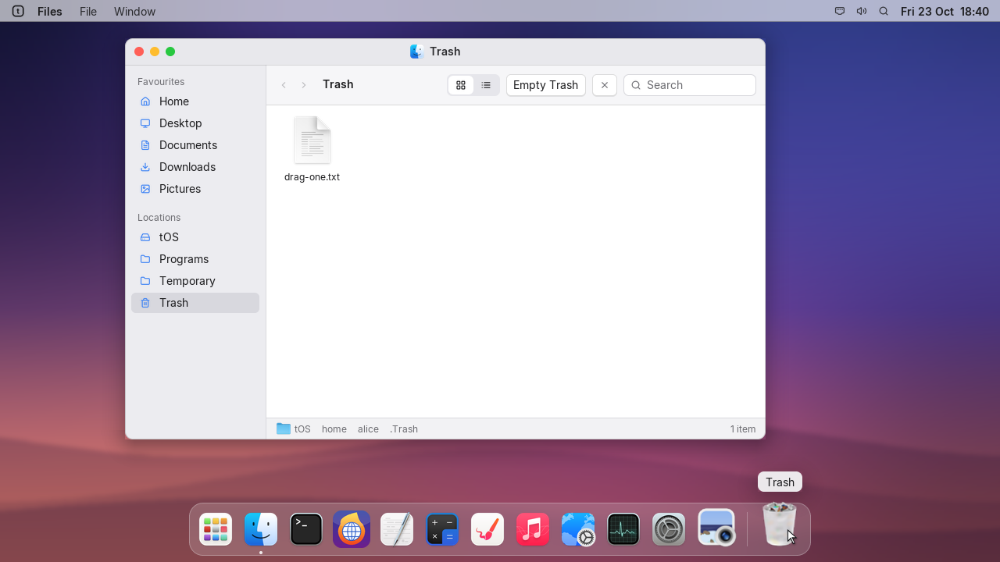
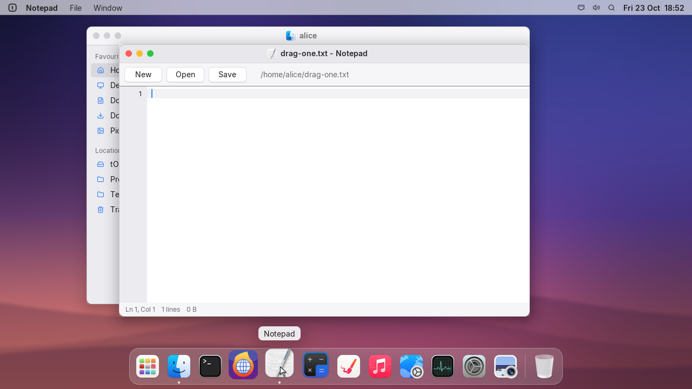
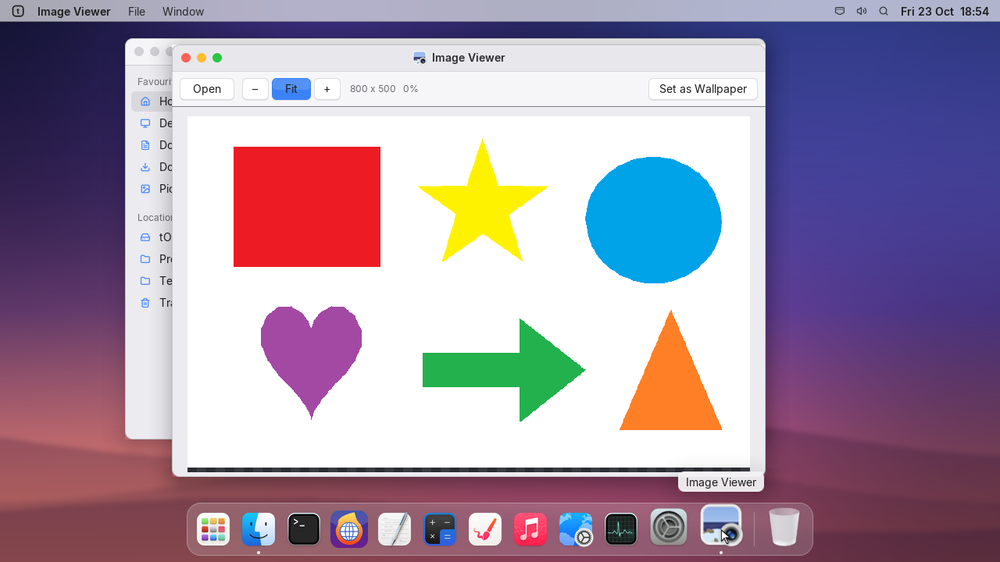
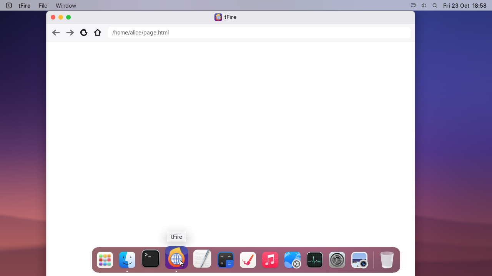
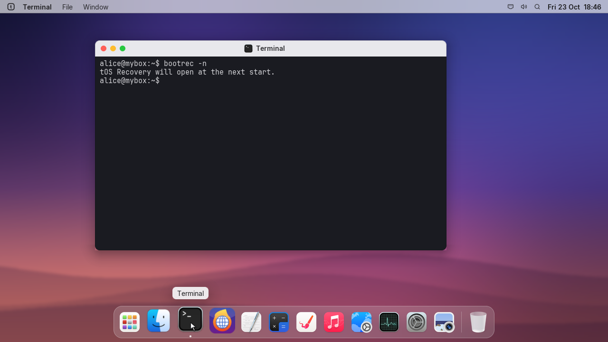
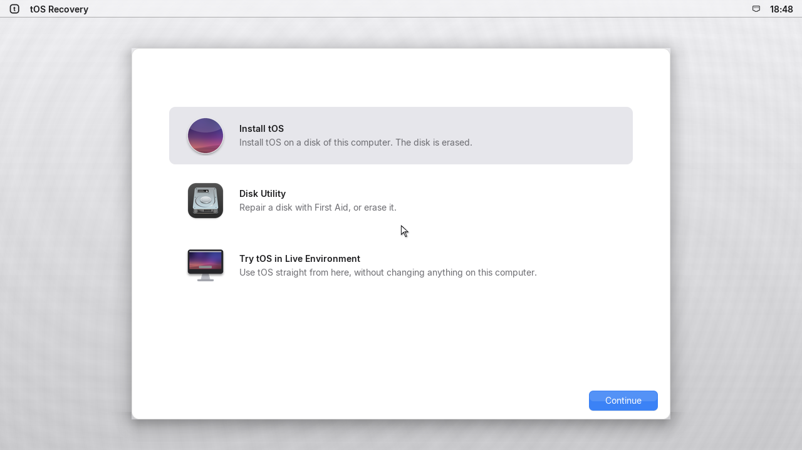

# Files that move, and tOS Recovery when you need it

## files | Files, Desktop and Trash
- Drag files and folders from Files to the Desktop, another folder, or another Files window.
- Select several items with Ctrl-click or a Shift-click range and move them together.
- Hold Alt/Option while dropping to copy instead of move; name conflicts get a new name.
- Deleting from Files moves items to the Trash. The Dock Trash shows when it is full; emptying it requires confirmation.

## launcher | Open files from the Dock
- Drop text documents on Notepad, pictures on Image Viewer, and HTML pages on tFire.
- A Dock target highlights while a compatible file is dragged over it.

## recovery | tOS Recovery
- Run `bootrec` to restart straight into Recovery, or `bootrec -n` to choose Recovery at the next start.
- Hold Shift while tOS starts to enter Recovery instead of the login screen.
- The one-time `bootrec -n` request is consumed on the next start; Recovery still offers Install tOS, Disk Utility, and Try tOS in Live Environment.

